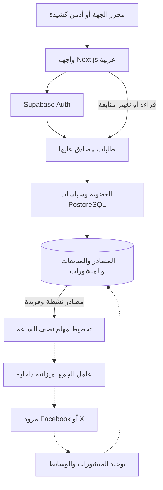

# من اختيار المصدر إلى تيار الجهة

أول قرار هندسي هو فصل متابعة الجهة عن هوية المصدر. تدفع الجهة ثمن خدمتها، وتُحسب طلبات المزود عند المصدر العام الفريد. إذا اختارت مزيد ٧٠ مصدرًا ورصد ٥٠، وتشترك القائمتان في ٢٠، نفحص ١٠٠ مصدر عند استحقاق الجميع. في ٣٠ يومًا على فترة نصف ساعة، يعادل ذلك ١٤٤٬٠٠٠ فحص مخطط قبل الاستكمال أو الإعادة. عدد الأرصدة النقدية يحتاج قياسًا من المزود.

## البنية

الأسهم المتقطعة تخص ربط الجمع الحي في المرحلة القادمة. وضع العرض يستخدم نفس شكل البيانات مع عينة محلية. وضع الدخول يستدعي دوال قاعدة البيانات باستخدام جلسة Supabase. تُحمّل الواجهة من استضافة ثابتة، بينما تعمل قواعد الرؤية والحصص داخل PostgreSQL.

## ماذا يحدث عند إضافة رابط؟

| الخطوة | سلوك المنصة |
|---|---|
| التعرّف | تُوحّد صيغ الرابط المعروفة. يشير الرابط الأساسي والاسم البديل المتحقق إلى معرف مصدر واحد. رابط غير معروف يُسجل كطلب ينتظر التحقق من كونه عامًا. |
| المتابعة | لكل جهة متابعة واحدة لكل مصدر. نفس الرابط أو المصدر المعروف المُضاف باسم بديل لا يستهلك مكانًا جديدًا. الطلب المنتظر يحجز مكانًا ويمكن إلغاؤه. |
| الحد | تُقفل قاعدة البيانات صف الجهة أثناء فحص الحد والكتابة. يستطيع أدمن كشيدة تعطيل إضافات الجهة أو ضبط حدها. |
| تخطيط الجمع | تُنتج دالة التخطيط مهمة واحدة لكل مصدر في نافذة نصف الساعة. تُستدعى حاليًا في الاختبارات. فتح الأخبار والبحث وتبديل الحساب لا يستدعيها. |
| التخزين والرؤية | يُعرّف المنشور بهوية المنصة ومعرفه الأصلي، ويُسجل ظهوره في كل مصدر على حدة. يعرض التيار المنشور مرة واحدة مع أسماء المصادر المسموح بها. |
| الإيقاف | تختفي أخبار المصدر من الجهة التي أوقفته. إذا ظهر نفس المنشور في مصدر آخر نشط للجهة يبقى ظاهرًا من خلال ذلك المصدر. |
| وقت الخبر | يُخزّن وقت رصد كل ظهور منفصلًا عن تاريخ نشر المنشور. الرصد المجهول تاريخ نشره يعرض «غير متاح». |

## حدود هذه النسخة

- مساحتان تجريبيتان، وثلاثة مصادر Facebook نشطة في البداية، وأربع متابعات، وحساب X محفوظ يمكن إضافته. لا اتصال بمزودي الأخبار. التبديل بين مزيد ورصد في المعاينة يحاكي حسابين ويعرض بيانات تمثيلية فقط.
- المصدر داخل السجل مؤكد مسبقًا. التحقق الخارجي من مصدر جديد، وتسوية الطلبات المعلقة إلى السجل المشترك، ينتظران ربط المزود. لا يبدأ جمع من جروب مجهول أو خاص.
- مسار Supabase يتضمن الدخول بالبريد وكلمة السر وسياسات رؤية على الصفوف. تحققت الاختبارات محليًا من صلاحيات المحررين والأدمن. تفعيل دخول مستضاف يحتاج مشروع تجربة وحسابين مربوطين بالعضويات.
- يعرض الخادم أحدث ١٠٠ منشور مرئي داخل نافذة عرض الجهة. البحث الحالي يفلتر هذه الدفعة. لاحقًا ننقل البحث والتصفح إلى الخادم حين يزيد حجم البيانات. سجل الاحتفاظ الداخلي والميزانية يخصان كشيدة.
- صفحة الترندات والمحتوى المتشابه تأتي بعد اختبار المصدر الحقيقي. ترندات Facebook من منشورات الجهة، وترندات X لمصر وعمليات بحث Google مساران منفصلان. تعرض أداة التشابه أدلة مرئية للمحرر عند الطلب.

## ترتيب العمل بعد هذه النسخة

1. دخول مستضاف بحسابين في بيئة تجربة ومعرّفي مستخدمين حقيقيين، ثم إعادة اختبار إيقاف المصدر والرؤية بواسطة جلسة كل حساب.
2. موصل Facebook من جانب الخادم، لصفحة وجروب عام معروفين. تشغيل يدوي بميزانية قصوى محددة مسبقًا، وتسجيل عدد الطلبات والخصم الحقيقي ووقت السحب وعدد المنشورات الجديدة. عند تعذّر معرفة الخصم تبقى المحاولة معلقة للتسوية. تُعتمد أول دورة مدفوعة عندما يسمح لها أدمن كشيدة من إعداد خاص بالخادم.
3. بعد قياس الخصم، نختبر تكرار الدورة وتحديث المنشور، ثم نوصل X مستقلاً، ثم التحليلات داخل بيانات الجهة. قبل توسيع الجدولة نضيف حجز الرصيد، ومنع تداخل العمال، وترقيم الصفحات عند تجاوز دفعة المزود، وسياسة حذف الوسائط المنتهية.

## مهمة Codex التالية

> افتح مستودع Monitoring-facebook-X واقرأ هذه الوثيقة وREADME. أكمل اختبار دخول محرر مزيد ومحرر رصد على مشروع Supabase التجريبي المجاني المخصص. طبّق الترحيل بعد فحص حالة المشروع، اربط مستخدمي التجربة بجهتيهما، واختبر المصدر المشترك وإيقافه بالجلسات الحقيقية. شغّل الاختبارات والبناء وسجّل النتائج في Pull Request. استعمل بيانات العينة فقط، واحتفظ بجميع أسرار الخادم خارج المستودع. اترك رصيد SocialAPIs دون استهلاك في هذه المهمة.
